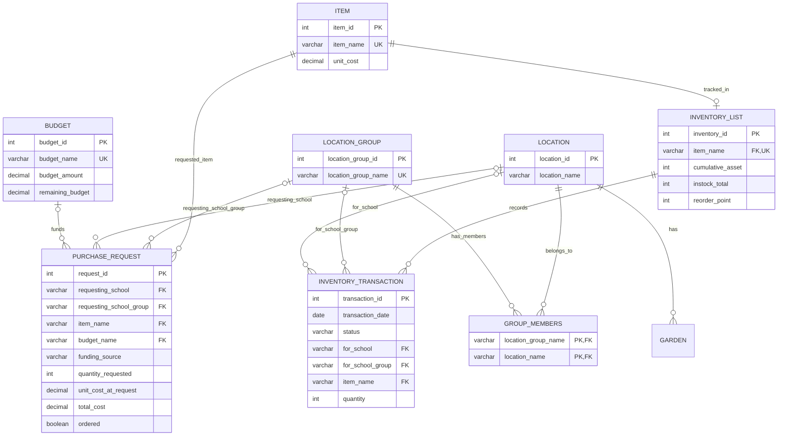
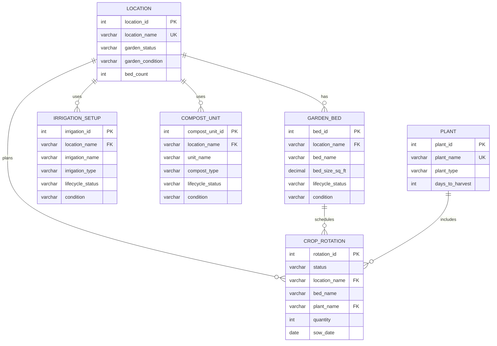

# LCSD Garden Program Database

This is a database project for the Lee County School District garden program that focuses on creating a more organized and centralized way to manage garden-related data. The project is based on the program's current use of Google Sheets and will support areas such as inventory and supplies, garden sizes and components, and growing calendars and crop rotations.

The goal is to improve how information is stored, connected, and accessed so staff can better track available resources, locations, distribution, budgets, and other garden program data over time.

## Setting up a new Supabase project

The project owner sets up the database and Auth integration. Partners do not need Supabase dashboard or organization access; they use an invited Supabase Auth account to sign in to the local app.

In the new project's Supabase dashboard, open **SQL Editor**. Run each SQL file below **one at a time**, in this order:

1. [`sql/schema_garden.sql`](sql/schema_garden.sql)
2. [`sql/schema_inventory.sql`](sql/schema_inventory.sql)
3. [`sql/summary_views.sql`](sql/summary_views.sql)
4. [`sql/demo_data.sql`](sql/demo_data.sql) only if you want its prewritten starter records; skip it if you are loading your own data
5. [`sql/roles_and_permissions.sql`](sql/roles_and_permissions.sql) last, after the tables and views exist

After the SQL files, enable the **Custom Access Token** hook in Supabase Auth using the Postgres function `public.custom_access_token_hook`. Invite the first manager through **Authentication → Users → Add user → Send invitation**, then use the SQL Editor to assign the initial app role. Replace the example email with that invited user's email:

```sql
INSERT INTO private.user_role_assignment (user_id, database_role)
SELECT u.id, 'database_manager'
FROM auth.users AS u
WHERE lower(u.email) = lower('manager@example.com')
ON CONFLICT (user_id)
DO UPDATE SET database_role = EXCLUDED.database_role
RETURNING user_id, database_role;
```

The query should return one row with `database_manager`. The project owner must also enable the Data API for the `public` schema and configure Auth's Site URL and Redirect URLs as `http://localhost:8000/`. Update `SUPABASE_URL` and `SUPABASE_PUBLISHABLE_KEY` in `frontend/app.py` with the new project's values, then commit and push that frontend configuration before partners use the GitHub updater. The publishable key may be in the public repository; never put a database password or Supabase secret/service-role key there.

### Emergency app-role recovery (project owner only)

Use these commands in the Supabase SQL Editor as the project owner. They change app-role assignments only; they do not delete Auth accounts or program records.

To revoke one person's app access while keeping their Auth account, replace the example email:

```sql
DELETE FROM private.user_role_assignment AS assignment
USING auth.users AS account
WHERE assignment.user_id = account.id
  AND lower(account.email) = lower('person@example.com')
RETURNING assignment.user_id, assignment.database_role;
```

To revoke every app role (this removes app access for everyone and leaves no manager who can restore access through the app):

```sql
DELETE FROM private.user_role_assignment
RETURNING user_id, database_role;
```

To restore a Database Manager or bootstrap a replacement, replace the example email with an existing Auth user's email:

```sql
INSERT INTO private.user_role_assignment (user_id, database_role)
SELECT u.id, 'database_manager'
FROM auth.users AS u
WHERE lower(u.email) = lower('manager@example.com')
ON CONFLICT (user_id)
DO UPDATE SET database_role = EXCLUDED.database_role
RETURNING user_id, database_role;
```

Role changes take effect when affected users receive a refreshed sign-in token. If all roles were removed, only the project owner can restore a manager with the SQL above.

See the [frontend README](frontend/README.md#project-administrator-set-up-a-new-supabase-project) for the full dashboard steps, Auth hook selection, user invitations, and app setup.

## Frontend App

The `frontend` folder contains a Python web app that runs on each user's computer at `http://localhost:8000`. It is not a public website; it connects over the internet to the shared Supabase project. Partners need Python 3.9 or newer, internet access, and an invited Garden Program account with an app role assigned by a database manager.

### Windows

Install Python 3.9 or newer from [python.org/downloads](https://www.python.org/downloads/). Enable the Python launcher during installation, reopen PowerShell, and confirm with `py --version`. Python itself must be installed first; the app launcher creates the virtual environment and installs its packages.

1. Download this repository from GitHub using **Code → Download ZIP**, then unzip it.
2. Open the extracted `Garden-Database-main` folder and then `frontend`. Keep the folder together; do not move `Run-GardenApp.exe` by itself.
3. Double-click `Run-GardenApp.exe`. It checks GitHub for frontend file updates, prepares Python and the required packages on first use, and starts the app in your browser. Leave its console window open while using the app.
4. If the executable does not work, open PowerShell in `frontend` and run `.\scripts\Run-GardenApp.ps1`.

To set up and run the app manually on Windows, open PowerShell in `frontend` and run:

```powershell
py -m venv .venv
.\.venv\Scripts\python.exe -m pip install -r requirements.txt
.\.venv\Scripts\python.exe app.py
```

Open `http://localhost:8000` in a browser. Leave PowerShell open while using the app; press **Ctrl+C** to stop it.

### macOS and Linux (including Kali)

1. Download the repository ZIP from GitHub using **Code → Download ZIP**, then unzip it.
2. Install Python 3.9 or newer if needed. On macOS, install Python 3 from [python.org/downloads](https://www.python.org/downloads/) and verify it with `python3 --version`. On Kali or another Debian-based Linux, install Python and virtual environment support using `sudo apt update` followed by `sudo apt install python3 python3-venv python3-pip`. Then open Terminal in the extracted `Garden-Database-main/frontend` folder.
3. Create the environment, install packages, and start the app:

   ```bash
   python3 -m venv .venv
   .venv/bin/python -m pip install -r requirements.txt
   .venv/bin/python app.py
   ```

4. Open `http://localhost:8000` in a browser. Leave Terminal open while using the app; press **Ctrl+C** to stop it.

The Windows launcher and updater do not run on macOS/Linux. To get frontend updates on those systems, download and unzip the updated repository from GitHub, then run the commands above in its `frontend` folder.

Users do not need a Supabase dashboard account, database password, or connection URI. Each person signs in with their own invited Supabase Auth account; a manager must assign their app role before they can access records. Changes made in the app update the shared Supabase data. The app's updater only changes frontend files and never applies SQL or database schema changes. See [frontend/README.md](frontend/README.md) for complete setup and troubleshooting steps.

### Accounts and passwords

- The project administrator sends invitations through Supabase Auth. The app does not have public self-sign-up.
- Start the local app before opening an invitation or password-reset link. The link returns to `http://localhost:8000`, where the user can set a password.
- A manager assigns each invited account its app role from **Manage Users**. Until a role is assigned, the account cannot access program records. Managers can request password-reset emails from that page; invitations for new accounts still come from Supabase Auth.

### Common fixes

- **Python was not found:** Install Python 3.9 or newer, reopen PowerShell or Terminal, and check it with `py --version` on Windows or `python3 --version` on macOS/Linux.
- **No Garden Program role:** Ask a database manager to assign a role to the account used to sign in.
- **Cannot reach Supabase Auth or Data API:** Check that the computer has internet access.
- **Port 8000 is already in use:** Stop another running copy of the app before starting this one.
# What We Need to Work On

### Inventory & Supplies

Monitor seed stocks, tools, soil, and equipment across all campuses to avoid duplicate purchasing, prevent shortages, and allocate budgets effectively. The program currently has a rudimentary system for inventory management, supply requests, distribution of supplies, and restocking inventory. However, this could use some refinement.

### Garden Sizes & Components

Maintain up-to-date records of physical garden footprints, irrigation setups, composting units, and active bed counts for each school site.

### Growing Calendars & Crop Rotations

Plan planting schedules, manage crop rotations to maintain soil health, and track seasonal variations systematically while ensuring resources are prepared for the various growing cycles.


## Implementation

The garden schema defines shared types, locations, location groups, and garden tables. The inventory schema defines inventory and budget tables. The summary views report on those tables, and `roles_and_permissions.sql` configures roles, permissions, user display names, and audit logging. The new-project section above gives the exact SQL Editor order.

# Current Database Schema

The current inventory schema focuses on the inventory portion of the project(does not include all columns).



`LOCATION_GROUP` stores one row per group. `group_members` stores one row per member location, using readable group and location names as foreign keys.

The schema creates the built-in `All HLC Gardens` group and maintains membership for locations where `is_hlc` is `TRUE`, independently of garden status; demo data is not required. Purchase requests and inventory transactions may use one direct location, one location group, or neither for personal use; entering one assignment clears the other. Location and bed records with dependent garden records cannot be deleted.

The current garden schema focuses on the garden portion of the project(does not include all columns).



The app authenticates each partner through Supabase Auth. App roles are assigned to Auth users and enforced by the Supabase database policies; see `sql/roles_and_permissions.sql` and the Supabase setup guides.
