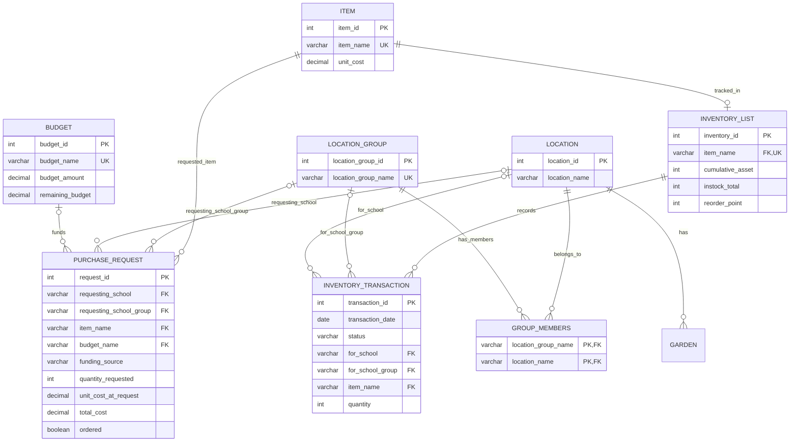
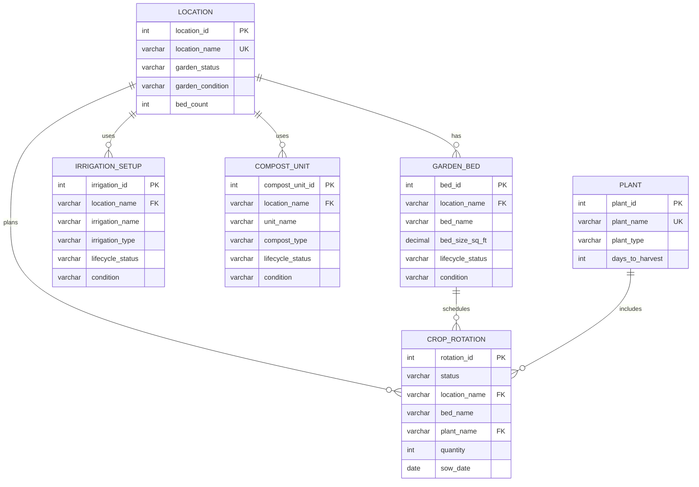

# LCSD Garden Program Database

This is a database project for the Lee County School District garden program that focuses on creating a more organized and centralized way to manage garden-related data. The project is based on the program's current use of Google Sheets and will support areas such as inventory and supplies, garden sizes and components, and growing calendars and crop rotations.

The goal is to improve how information is stored, connected, and accessed so staff can better track available resources, locations, distribution, budgets, and other garden program data over time.

## Setting up a new Supabase project

The project owner sets up the database and Auth integration. Users do not need Supabase dashboard or organization access; they use an invited Supabase Auth account to sign in to the local app.

If you are a regular app user and your project manager is handling the Supabase setup, skip this section and go to the [frontend README](frontend/README.md) for instructions on installing and using the app.

Open the [Supabase dashboard](https://supabase.com/dashboard) to create or select the organization and project.

Regular app users should **not** be added to the Supabase organization. A manager invites them through Supabase Auth, and they use the app; the head Garden Program manager oversees Supabase.

In **Organization Settings → Team**, invite only people who manage or develop the Supabase project. Keep an organization-controlled account as **Owner** for long-term ownership and recovery. Give the head manager **Administrator** and database or frontend developers **Developer**. Owners have full access; Administrators can manage projects but cannot change organization settings, transfer projects, or add Owners; Developers can change project content, including database content, but not project settings. See Supabase's [access control documentation](https://supabase.com/docs/guides/platform/access-control).

Before configuring the Auth hook, set the password requirements in **Authentication → Sign In / Providers → Email**: require at least 8 characters, including lowercase and uppercase letters, a number, and a symbol.

In the new project's Supabase dashboard, open **SQL Editor**. Run each SQL file below **one at a time**, in this order:

1. [`sql/schema_garden.sql`](sql/schema_garden.sql)
2. [`sql/schema_inventory.sql`](sql/schema_inventory.sql)
3. [`sql/summary_views.sql`](sql/summary_views.sql)
4. [`sql/demo_data.sql`](sql/demo_data.sql) for demo purposes if you want to try the app with sample records; skip it if you plan to import your own data
5. [`sql/roles_and_permissions.sql`](sql/roles_and_permissions.sql) last, after the tables and views exist

If you are an authorized project maintainer setting up a different Supabase project, copy its **Project URL** from **Project Settings → Integrations → Data API** and its **Publishable key** from **Project Settings → API Keys**. Put the base Project URL, without `/rest/v1/`, in `SUPABASE_URL` and the key in `SUPABASE_PUBLISHABLE_KEY` in `frontend/app.py`. Skip this if the developer is setting up the project with you; otherwise, commit and push the configuration before users download or update the app. Regular app users should use the configured files and should not replace these values. Never put a database password or Secret/`service_role` key in the frontend or repository.

After the SQL files, open **Authentication → Auth Hooks → Add Hook** in Supabase. Choose **Custom Access Token**, set **Hook Type** to **Postgres** (not HTTPS), select schema **`public`** and function **`custom_access_token_hook`**, then save the hook. When Supabase issues a user's sign-in token, this hook adds that user's assigned app role to it so the database can apply the correct permissions.

Invite the first manager through **Authentication → Users → Add user → Send invitation**, then use the SQL Editor to assign the initial app role. Replace the example email with that invited user's email:

```sql
INSERT INTO private.user_role_assignment (user_id, database_role)
SELECT u.id, 'database_manager'
FROM auth.users AS u
WHERE lower(u.email) = lower('manager@example.com')
ON CONFLICT (user_id)
DO UPDATE SET database_role = EXCLUDED.database_role
RETURNING user_id, database_role;
```

The query should return one row with `database_manager`.

Go to **Project Settings → Integrations → Data API** and enable the Data API. Then go to **Authentication → URL Configuration** and set the **Site URL** and **Redirect URLs** to `http://localhost:8000/` so invitation and password-reset links return to the local app.

### Inviting users and managing access

After users download the repository, invite each person in Supabase under **Authentication → Users → Add user → Send invitation**. Users must start the local app before opening the invitation link. The app opens so they can set their password and sign in. A Database Manager then assigns their app role from **Manage Users**; they can access garden information after a role is assigned. Regular app users do not need Supabase organization membership.

To assign or reassign an existing Auth user as a Database Manager, run the manager-assignment SQL above in the Supabase SQL Editor, replacing `manager@example.com` with that user's email. The `ON CONFLICT` clause updates an existing app role to `database_manager`.

To revoke a manager's app role while leaving the Auth account in place, run this as the project owner in the Supabase SQL Editor, replacing the example email:

```sql
DELETE FROM private.user_role_assignment AS assignment
USING auth.users AS account
WHERE assignment.user_id = account.id
  AND lower(account.email) = lower('manager@example.com')
RETURNING assignment.user_id, assignment.database_role;
```

To remove a person's sign-in account entirely, an authorized Supabase administrator goes to **Authentication → Users**, finds the account, chooses **Delete user**, and confirms. This also removes the account's app role and display-name profile, but does not delete existing Garden Program records. See the [Supabase user guide](docs/supabase_user_guide.md) for more account-management details.

For help with Supabase invitations, sign-in, app roles, Auth Hooks, or Data API connections, see the [Supabase user guide troubleshooting section](docs/supabase_user_guide.md#9-troubleshooting).

## Frontend App

The `frontend` folder contains a Python web app that runs on each user's computer at `http://localhost:8000`. Each user needs to download this GitHub repository onto their device and run the app from its `frontend` folder. The app is not a public website; it connects over the internet to the shared Supabase project.

Its role-based interface gives each user the appropriate tools to manage Garden Program information. The head project manager and other Supabase organization members can also work directly in the Supabase dashboard when needed, but the frontend is the recommended place for day-to-day garden database work. Users need Python 3.9 or newer, internet access, and an invited Garden Program account with an app role assigned by a database manager.

For full installation, sign-in, and troubleshooting instructions, see the [frontend README](frontend/README.md).
# Project

### Inventory & Supplies

Monitor seed stocks, tools, soil, and equipment across all campuses to avoid duplicate purchasing, prevent shortages, and allocate budgets effectively. The program currently has a rudimentary system for inventory management, supply requests, distribution of supplies, and restocking inventory. However, this could use some refinement.

### Garden Sizes & Components

Maintain up-to-date records of physical garden footprints, irrigation setups, composting units, and active bed counts for each school site.

### Growing Calendars & Crop Rotations

Plan planting schedules, manage crop rotations to maintain soil health, and track seasonal variations systematically while ensuring resources are prepared for the various growing cycles.


# Current Database Schema

The current inventory schema focuses on the inventory portion of the project(does not include all columns).



`LOCATION_GROUP` stores one row per group. `group_members` stores one row per member location, using readable group and location names as foreign keys.

The schema creates the built-in `All HLC Gardens` group and maintains membership for locations where `is_hlc` is `TRUE`, independently of garden status; demo data is not required. Purchase requests and inventory transactions may use one direct location, one location group, or neither for personal use; entering one assignment clears the other. Location and bed records with dependent garden records cannot be deleted.

The current garden schema focuses on the garden portion of the project(does not include all columns).



The app authenticates each user through Supabase Auth. App roles are assigned to Auth users and enforced by the Supabase database policies; see `sql/roles_and_permissions.sql` and the Supabase setup guides.
