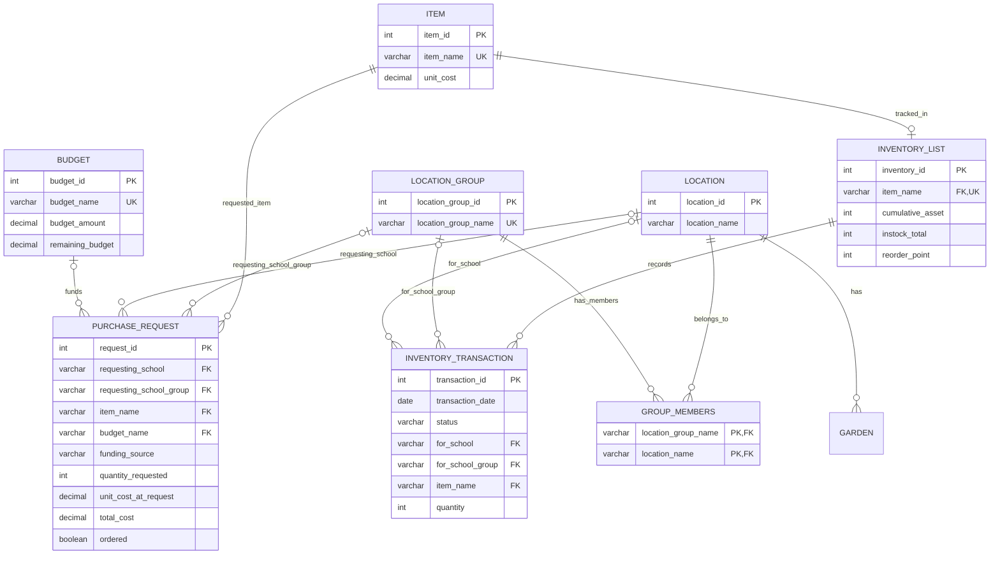
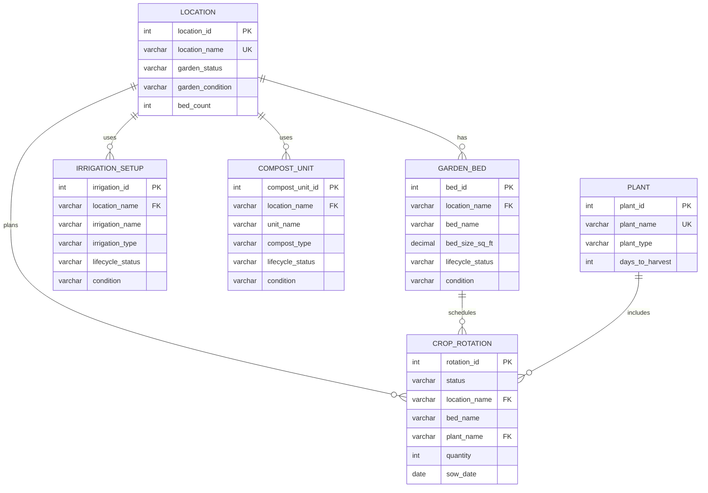

# LCSD Garden Program Database

This is a database project for the Lee County School District garden program that focuses on creating a more organized and centralized way to manage garden-related data. The project is based on the program's current use of Google Sheets and will support areas such as inventory and supplies, garden sizes and components, and growing calendars and crop rotations.

The goal is to improve how information is stored, connected, and accessed so staff can better track available resources, locations, distribution, budgets, and other garden program data over time.

## Frontend App

The `frontend` folder contains a Python web app for working with the Garden Program database. The app runs locally on each user's computer and opens at `http://localhost:8000`; it is not hosted as a public website. It connects over the internet to the shared Supabase database, so changes made in the app affect the shared records.

For Python installation, the Windows executable and PowerShell fallback, manual setup, and Supabase connection instructions, see the [frontend setup guide](frontend/README.md).

# What We Need to Work On

### Inventory & Supplies

Monitor seed stocks, tools, soil, and equipment across all campuses to avoid duplicate purchasing, prevent shortages, and allocate budgets effectively. The program currently has a rudimentary system for inventory management, supply requests, distribution of supplies, and restocking inventory. However, this could use some refinement.

### Garden Sizes & Components

Maintain up-to-date records of physical garden footprints, irrigation setups, composting units, and active bed counts for each school site.

### Growing Calendars & Crop Rotations

Plan planting schedules, manage crop rotations to maintain soil health, and track seasonal variations systematically while ensuring resources are prepared for the various growing cycles.

# IMPLEMENTATION
The garden schema is loaded first and defines shared types, locations, location groups, and garden tables. The inventory schema is loaded next and defines inventory and budget tables. Then load the summary views and demo data. Run `sql/schema_roles.sql` last in Supabase to configure database roles and access rules.

# Current Database Schema

The current inventory schema focuses on the inventory portion of the project(does not include all columns).

`LOCATION_GROUP` stores one row per group. `group_members` stores one row per member location, using readable group and location names as foreign keys.

The schema creates the built-in `All HLC Gardens` group and maintains membership for locations where `is_hlc` is `TRUE`, independently of garden status; demo data is not required. Purchase requests and inventory transactions may use one direct location, one location group, or neither for personal use; entering one assignment clears the other. Location and bed records with dependent garden records cannot be deleted.

The current garden schema focuses on the garden portion of the project(does not include all columns).

**Developer notes: We use component names as foreign key for user readability for hosted databases. If a future web UI is implemented, change back foreign key to ID for proper use.    
> Authentication and user tracking are planned for a future stage of the project and are not currently part of the inventory schema.
